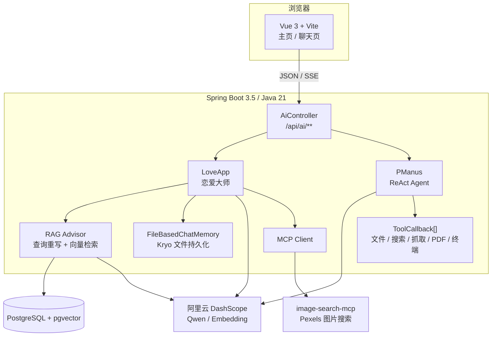

<div align="center">

# P · PRISM

**一束智能，两种性情。**

一个把 AI 应用做成作品的个人项目：Spring AI Alibaba 驱动后端，Vue 3 打造界面，
把 **RAG、ReAct Agent、MCP 工具链与流式对话** 组合成两个可用的 AI 应用。

[](https://openjdk.org/)
[](https://spring.io/projects/spring-boot)
[](https://spring.io/projects/spring-ai)
[](https://vuejs.org/)
[](https://vitejs.dev/)
[](https://github.com/pgvector/pgvector)

</div>

> 项目状态：开发中。接口与配置可能随迭代调整，欢迎交流与提 Issue。

---

## 目录

- [项目简介](#项目简介)
- [两个应用](#两个应用)
- [技术栈](#技术栈)
- [系统架构](#系统架构)
- [目录结构](#目录结构)
- [快速开始](#快速开始)
- [配置说明](#配置说明)
- [API 一览](#api-一览)
- [核心实现](#核心实现)
- [MCP 图片搜索服务](#mcp-图片搜索服务)
- [部署](#部署)
- [安全提示](#安全提示)
- [常见问题](#常见问题)
- [License](#license)

---

## 项目简介

P-Prism 不是一个单独的聊天页面，而是一套 **可复用的 AI 应用底座**：

- 一个 Spring Boot 后端，统一管理模型调用、RAG 检索、Agent 工具、会话记忆和 SSE 流式输出；
- 一个 Vue 3 前端，用同一份应用注册表驱动主页、路由和聊天界面；
- 一个独立的 MCP Server，把「图片搜索」这类外部能力做成可插拔工具；
- 统一的响应结构、全局异常处理、参数校验和健康检查，方便继续扩展新的 AI 应用。

目前内置两个截然不同的应用：

| 应用 | 定位 | 能力关键词 |
| --- | --- | --- |
| **AI 恋爱大师** | 有记忆、有知识库的情感陪伴助手 | RAG、多轮记忆、查询重写、SSE |
| **AI 超级智能体 PManus** | 能自主规划并调用工具的通用 Agent | ReAct、工具调用、任务拆解、SSE |

---

## 两个应用

### 01 · AI 恋爱大师 `Love Mentor`

- 以恋爱心理专家的人设开场，围绕 **单身 / 恋爱中 / 已婚** 三种状态引导对话；
- 支持多轮上下文，会话记忆按 `chatId` 持久化到本地文件；
- 接入 PGVector 知识库，回答前先做 **查询重写 → 向量检索 → 上下文增强**；
- 检索不到相关内容时，有专门的兜底话术，避免模型胡编；
- 提供同步、`Flux` SSE、`SseEmitter` 三种调用方式。

### 02 · AI 超级智能体 `PManus`

- 基于 **ReAct（Reasoning + Acting）** 的 `think → act` 循环，最多执行 20 步；
- 自主拆解任务，并按需组合调用工具：

  | 工具 | 作用 |
  | --- | --- |
  | `FileOperationTool` | 读写本地文件 |
  | `WebSearchTool` | 通过 SearchAPI 调用百度搜索 |
  | `WebScrapingTool` | 使用 Jsoup 抓取网页内容 |
  | `ResourceDownloadTool` | 下载网络资源到本地 |
  | `TerminalOperationTool` | 执行终端命令（Windows `cmd.exe`） |
  | `PDFGenerationTool` | 使用 iText 生成中文 PDF |
  | `TimeTools` | 获取当前系统时间 |
  | `TerminateTool` | 主动结束任务 |

- 每一步执行结果通过 SSE 实时推送，前端按「执行步骤」分段展示。

### 工程能力

- **统一响应**：`BaseResponse<T>` + `ResultUtils`，错误码集中管理；
- **全局异常**：参数校验、业务异常、系统异常统一处理；
- **接口文档**：Knife4j / OpenAPI 3；
- **健康检查**：`GET /api/health/`，前端主页可直接探测服务状态；
- **会话记忆**：基于 Kryo 的文件存储，按会话 ID 分文件保存；
- **知识库增量初始化**：通过文档内容 SHA-256 指纹判断是否需要重新向量化；
- **容器化**：提供 `Dockerfile`，前端提供 `vercel.json`。

---

## 技术栈

### 后端

| 分类 | 技术 |
| --- | --- |
| 语言 / 运行时 | Java 21 |
| 框架 | Spring Boot 3.5.16、Spring Web、Spring Validation |
| AI | Spring AI 1.0.0-M6、Spring AI Alibaba 1.0.0-M6.1 |
| 模型 | 阿里云百炼 DashScope · Qwen 系列 |
| RAG | Spring AI RAG、PGVector、Markdown Document Reader |
| 数据库 | PostgreSQL + pgvector（HNSW / COSINE） |
| MCP | Spring AI MCP Client、Spring AI MCP Server |
| 工具库 | Hutool、Jsoup、iText、Kryo、Lombok |
| API 文档 | Knife4j 4.4.0 |

### 前端

| 分类 | 技术 |
| --- | --- |
| 框架 | Vue 3.5（Composition API） |
| 构建 | Vite 5.4 |
| 路由 | Vue Router 4 |
| 请求 | Axios + 原生 `fetch` 流式读取 |
| 渲染 | marked + DOMPurify |
| 部署 | Vercel（可选） |

---

## 系统架构



一次请求的典型链路：

1. 前端 `GET /api/ai/...` 发起请求；
2. Controller 校验参数并生成 / 复用 `chatId`；
3. `LoveApp` 走 RAG + 记忆链路，`PManus` 走 ReAct 循环；
4. 模型通过 SSE 逐字或逐步骤返回；
5. 前端解析 SSE 事件流，实时更新气泡内容。

---

## 目录结构

```text
P-Prism/
├── src/main/java/com/pp/pprism/
│   ├── advisor/              # 自定义日志 Advisor、Re2 Advisor
│   ├── agent/model/          # BaseAgent / ReActAgent / ToolCallAgent / PManus
│   ├── app/                  # LoveApp 恋爱大师
│   ├── chatmemory/           # 基于 Kryo 的文件会话记忆
│   ├── common/               # 统一响应、分页 / 删除请求对象
│   ├── config/               # DashScope、RAG、CORS 配置
│   ├── controller/           # AI 接口、健康检查
│   ├── exception/            # 业务异常、错误码、全局异常处理
│   ├── rag/                  # 文档加载、关键词增强、查询重写、检索增强
│   └── tools/                # Agent 可调用的本地工具
├── src/main/resources/
│   ├── document/             # 恋爱知识库 Markdown
│   ├── application.yaml      # 主配置
│   ├── application-local.yaml# 本地密钥配置（已被 .gitignore 忽略）
│   └── mcp-server.json       # MCP Server 启动配置
├── fronted/                  # Vue 3 前端（目录名为历史拼写）
│   ├── src/api/              # Axios 与 SSE 封装
│   ├── src/components/       # 聊天气泡、输入框、Markdown 渲染
│   ├── src/composables/      # useChat 聊天状态机
│   ├── src/config/apps.js    # 应用注册表
│   ├── src/views/            # 主页与聊天页
│   └── vite.config.js        # 开发代理：/api → localhost:8123
├── image-search-mcp/         # 独立 MCP Server：Pexels 图片搜索
├── Dockerfile
├── pom.xml
└── README.md
```

> 前端目录名 `fronted` 是项目早期就保留下来的拼写，并非文档笔误。

---

## 快速开始

### 环境要求

| 依赖 | 版本建议 |
| --- | --- |
| JDK | 21 |
| Maven | 3.9+（项目自带 `mvnw`） |
| Node.js | 18+（建议 20 LTS） |
| PostgreSQL | 16+，并安装 `pgvector` 扩展 |
| DashScope | 已开通阿里云百炼，获取 API Key |
| SearchAPI | 可选，PManus 的联网搜索需要 |

### 1. 准备 PostgreSQL + pgvector

项目默认连接：

```text
jdbc:postgresql://localhost:5433/p-prism
username: postgres
password: root
```

如果本机没有现成数据库，可以用 Docker 快速启动：

```bash
docker run -d --name p-prism-pg \
  -p 5433:5432 \
  -e POSTGRES_DB=p-prism \
  -e POSTGRES_USER=postgres \
  -e POSTGRES_PASSWORD=root \
  pgvector/pgvector:pg16

docker exec -it p-prism-pg psql -U postgres -d p-prism \
  -c "CREATE EXTENSION IF NOT EXISTS vector;"
```

> 也可以使用已有的 PostgreSQL，只需保证库名、端口、账号密码与配置一致，并已启用 `vector` 扩展。

### 2. 配置 API Key

`src/main/resources/application-local.yaml` 默认被激活，且已被 `.gitignore` 忽略，适合放本地密钥。创建该文件：

```yaml
# src/main/resources/application-local.yaml
spring:
  ai:
    dashscope:
      api-key: ${AI_DASHSCOPE_API_KEY}

search-api:
  api-key: ${SEARCH_API_KEY}
```

然后在启动前设置环境变量：

```bash
# macOS / Linux
export AI_DASHSCOPE_API_KEY=sk-xxxxxxxx
export SEARCH_API_KEY=xxxxxxxx

# Windows PowerShell
$env:AI_DASHSCOPE_API_KEY="sk-xxxxxxxx"
$env:SEARCH_API_KEY="xxxxxxxx"
```

> 不要把真实密钥写进 `application.yaml` 或提交到仓库。
> 如果暂时不使用 PManus 的搜索能力，也必须保证 `search-api.api-key` 有值，否则 `ToolRegistration` 启动时会因占位符无法解析而失败。

### 3. 启动后端

```bash
# macOS / Linux
./mvnw spring-boot:run

# Windows
mvnw.cmd spring-boot:run
```

默认地址：

```text
http://localhost:8123/api
```

### 4. 启动前端

```bash
cd fronted
npm install
npm run dev
```

Vite 会把 `/api` 代理到 `http://localhost:8123`，打开：

```text
http://localhost:5173
```

### 5. 验证

| 地址 | 用途 |
| --- | --- |
| `http://localhost:5173` | 前端主页 |
| `http://localhost:5173/love` | AI 恋爱大师 |
| `http://localhost:5173/manus` | AI 超级智能体 |
| `http://localhost:8123/api/health/` | 后端健康检查 |
| `http://localhost:8123/api/doc.html` | Knife4j 接口文档 |

健康检查返回示例：

```json
{
  "code": 0,
  "data": "ok",
  "message": ""
}
```

---

## 配置说明

核心配置位于 `src/main/resources/application.yaml`：

| 配置项 | 说明 | 默认值 |
| --- | --- | --- |
| `server.port` | 后端端口 | `8123` |
| `server.servlet.context-path` | 全局接口前缀 | `/api` |
| `spring.profiles.active` | 激活的配置环境 | `local` |
| `spring.ai.dashscope.api-key` | DashScope API Key | `${AI_DASHSCOPE_API_KEY}` |
| `spring.ai.dashscope.chat.options.model` | 对话模型 | Qwen 系列 |
| `spring.datasource.url` | PostgreSQL 连接 | `jdbc:postgresql://localhost:5433/p-prism` |
| `spring.datasource.username` | 数据库用户名 | `postgres` |
| `spring.datasource.password` | 数据库密码 | `root` |
| `spring.ai.vectorstore.pgvector.*` | 向量索引 / 维度 / 距离算法 | HNSW、1024、COSINE |
| `search-api.api-key` | SearchAPI 搜索 Key | 无默认值，必须配置 |

模型的实际创建位置在 `config/DashScopeChatModelConfig.java`，如需切换模型，修改其中的 `withModel(...)`，或调整 `application.yaml` 中的模型配置。

RAG 参数位于 `config/RagConfig.java`：

- `similarityThreshold = 0.5`
- `topK = 3`

知识库文档放在 `src/main/resources/document/*.md`。应用启动就绪后会计算文档指纹：

- 内容没变且向量表已有数据 → 跳过重复向量化；
- 内容变化 → 重新做关键词增强、清理旧数据并写入向量库；
- 初始化失败不会阻塞应用启动，但 RAG 功能不可用，需查看日志。

---

## API 一览

所有接口均带 `/api` 前缀。

| 方法 | 路径 | 说明 | 返回 |
| --- | --- | --- | --- |
| `GET` | `/api/health/` | 健康检查 | `BaseResponse<String>` |
| `GET` | `/api/ai/love_app/chat/sync` | 恋爱大师同步对话 | `BaseResponse<String>` |
| `GET` | `/api/ai/love_app/chat/sse` | 恋爱大师流式对话 | `text/event-stream` |
| `GET` | `/api/ai/love_app/chat/sse/emitter` | 基于 `SseEmitter` 的流式对话 | `text/event-stream` |
| `GET` | `/api/ai/manus/chat` | PManus 智能体执行任务 | `text/event-stream` |

### 请求参数

| 参数 | 必填 | 说明 |
| --- | --- | --- |
| `message` | 是 | 用户消息 / 任务描述，不能为空 |
| `chatId` | 否 | 会话 ID；不传会自动生成，用于恋爱大师的多轮记忆 |

### 调用示例

```bash
# 同步对话
curl "http://localhost:8123/api/ai/love_app/chat/sync?message=我最近和对象总是吵架&chatId=demo-1"

# 流式对话
curl -N "http://localhost:8123/api/ai/love_app/chat/sse?message=你好&chatId=demo-1"

# 智能体执行任务
curl -N "http://localhost:8123/api/ai/manus/chat?message=帮我搜索今天的科技新闻并整理成简报"
```

---

## 核心实现

### RAG 链路

`LoveApp` 的 RAG 由 `RetrievalAugmentationAdvisor` 统一编排：

```text
用户问题
  → RewriteQueryTransformer（查询重写）
  → VectorStoreDocumentRetriever（PGVector 检索，topK=3）
  → ContextualQueryAugmenter（注入上下文）
  → ChatClient 生成回答
```

- **文档加载**：`LoveAppDocumentLoader` 读取 `classpath:document/*.md`；
- **关键词增强**：`MyKeywordEnricher` 为每个文档生成 5 个关键词元数据；
- **增量更新**：`PgVectorVectorStoreConfig` 用 SHA-256 指纹判断文档是否变化；
- **去重**：重新入库前按 `filename` 删除旧向量，避免重复数据；
- **空上下文兜底**：检索不到内容时，明确告知用户只能回答恋爱相关问题。

### ReAct Agent

`PManus` 继承 `ToolCallAgent`，核心循环在 `BaseAgent` 中：

```text
用户任务
  → think()：模型判断是否需要调用工具
  → act()：执行工具并把结果写回上下文
  → 重复，直到模型给出最终回答或调用 doTerminate
  → 达到 maxSteps（20）后强制结束
```

- 使用 DashScope 的 `withProxyToolCalls(true)`，由 Agent 自己维护消息上下文；
- `ToolCallAgent.step()` 在无需调用工具时直接返回模型文本，避免只返回占位提示；
- `runStream()` 通过 `CompletableFuture` 异步执行，并用 `SseEmitter` 逐步推送结果；
- 设置了 5 分钟超时和完成 / 超时回调，避免连接悬挂。

### 会话记忆

`FileBasedChatMemory` 实现了 Spring AI 的 `ChatMemory`：

- 每个 `chatId` 对应 `temp/chat-memory/{chatId}.kryo`；
- 使用 Kryo 序列化消息列表；
- 默认每次取最近 10 条消息作为上下文；
- 不依赖 Redis / 数据库，适合本地开发与单机部署。

### SSE 流式输出

后端提供两种流式方式：

- `Flux<String>`：Spring WebFlux 风格，适合纯文本逐字输出；
- `SseEmitter`：适合 Agent 这类需要主动推送多个步骤的场景。

前端没有使用 `EventSource`，而是用 `fetch` + `ReadableStream` 手动解析 SSE：

- 避免 `EventSource` 在服务端正常关闭后自动重连，导致重复请求；
- 支持 `AbortController`，用户可随时停止生成；
- 兼容多行 `data:` 和心跳注释行。

---

## MCP 图片搜索服务

`image-search-mcp/` 是一个独立的 Spring AI MCP Server，对外暴露 `searchImage` 工具，内部调用 Pexels 图片搜索 API。

### 构建

```bash
cd image-search-mcp
./mvnw clean package -DskipTests
```

构建产物：

```text
image-search-mcp/target/image-search-mcp-0.0.1-SNAPSHOT.jar
```

### 启用

主应用的 `application.yaml` 中默认注释了 MCP Client 配置。取消注释：

```yaml
spring:
  ai:
    mcp:
      client:
        stdio:
          servers-configuration: classpath:mcp-server.json
```

`mcp-server.json` 会以 stdio 方式启动上面的 jar。启动主应用前，请确保：

1. `image-search-mcp` 已成功打包；
2. 工作目录与 `mcp-server.json` 中的相对路径一致；
3. 已在 `ImageSearchTool` 中配置有效的 Pexels API Key（建议改为环境变量 / 配置项注入）。

启用后，`LoveApp.doChatWithTools()` 会把本地工具与 MCP 工具合并后交给模型调用。

---

## 部署

### 后端 Docker

```bash
docker build -t p-prism:latest .

docker run -d --name p-prism \
  -p 8123:8123 \
  -e AI_DASHSCOPE_API_KEY=sk-xxxxxxxx \
  -e SEARCH_API_KEY=xxxxxxxx \
  p-prism:latest
```

`Dockerfile` 默认以 `--spring.profiles.active=prod` 启动。仓库中没有提交 `application-prod.yaml`，请根据部署环境自行提供，或通过环境变量覆盖数据库、密钥等配置。

> 数据库不在容器内，请确保容器能访问 PostgreSQL，并把 `spring.datasource.url` 指向正确地址。

### 前端 Vercel

`fronted/vercel.json` 已配置好 Vite 构建与 SPA 路由回退：

```json
{
  "framework": "vite",
  "buildCommand": "npm run build",
  "outputDirectory": "dist",
  "rewrites": [{ "source": "/(.*)", "destination": "/index.html" }]
}
```

在 Vercel 中导入仓库时：

- **Root Directory** 选择 `fronted`；
- 配置环境变量 `VITE_API_BASE`，例如 `https://your-backend.example.com/api`；
- 后端需要允许该前端域名跨域（当前 `CorsConfig` 放行了所有来源，生产环境建议收紧）。

---

## 安全提示

PManus 具备 **终端命令执行、文件读写、资源下载** 等能力，属于高权限 Agent：

- 不要直接把服务暴露到公网；
- 不要在包含敏感文件的目录下运行；
- 生产环境建议禁用或替换 `TerminalOperationTool`；
- 所有 API Key 都应通过环境变量或配置中心注入，不要提交到 Git；
- 如果需要多用户使用，必须补充鉴权、限流和工具白名单。

---

## 常见问题

### 1. 启动报 `Could not resolve placeholder 'search-api.api-key'`

没有配置 SearchAPI Key。请在 `application-local.yaml` 中添加：

```yaml
search-api:
  api-key: ${SEARCH_API_KEY}
```

并确保环境变量 `SEARCH_API_KEY` 已设置。

### 2. 连接 PostgreSQL 失败

检查：

- PostgreSQL 是否启动；
- 端口是否为 `5433`（默认配置）；
- 数据库 `p-prism` 是否已创建；
- 用户名 / 密码是否与 `application.yaml` 一致。

### 3. 报 `extension "vector" is not available`

当前 PostgreSQL 未安装 pgvector。使用支持 pgvector 的镜像，或在数据库中执行：

```sql
CREATE EXTENSION IF NOT EXISTS vector;
```

### 4. RAG 回答没有用到知识库

查看启动日志中是否有：

```text
知识库文档已变化，完成关键词增强与向量化
```

或：

```text
知识库文档未变化，跳过关键词增强与向量化
```

如果出现 `知识库初始化失败`，优先检查 DashScope Key、Embedding 权限和数据库连接。

### 5. 前端请求 404 / 跨域

- 开发环境确认 Vite 代理生效：`/api` → `http://localhost:8123`；
- 确认后端 `context-path` 为 `/api`；
- 生产环境确认 `VITE_API_BASE` 指向完整的后端地址，并检查 CORS 配置。

### 6. PManus 没有调用 MCP 工具

MCP Client 默认是关闭的。请先构建 `image-search-mcp`，再取消 `application.yaml` 中 `spring.ai.mcp.client.stdio` 的注释，然后重启主应用。

---

## License

本项目暂未附带 `LICENSE` 文件，默认保留所有权利。如需引用、二次开发或分发，请先联系作者。

---

<div align="center">

**P · PRISM** — 让复杂的 AI 能力，看起来像一件作品。

Made with Spring AI Alibaba & Vue 3

</div>
